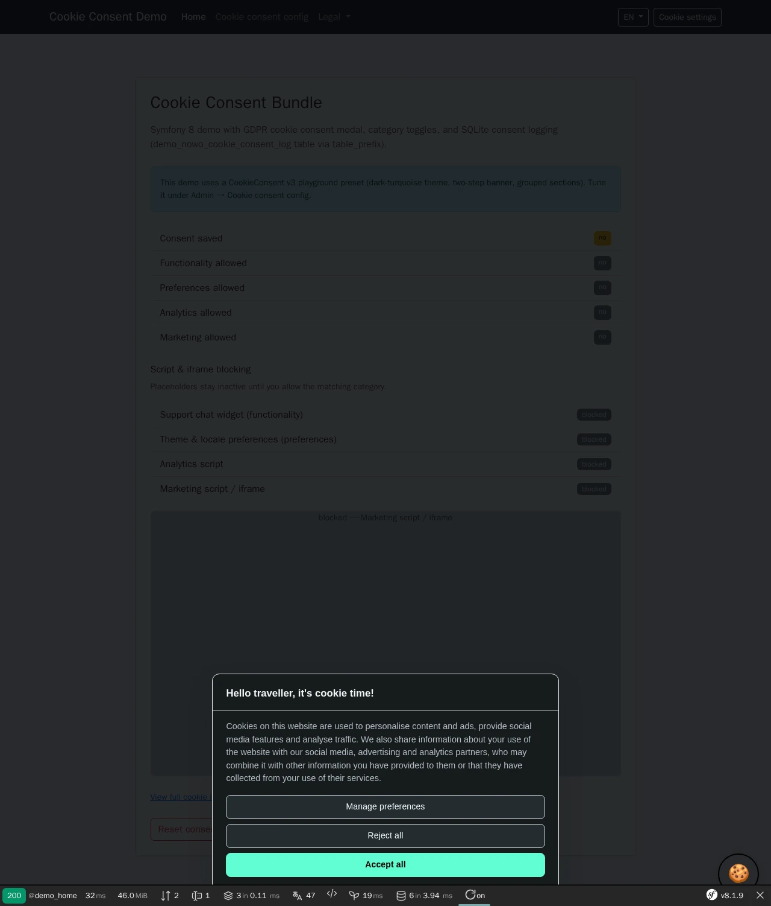
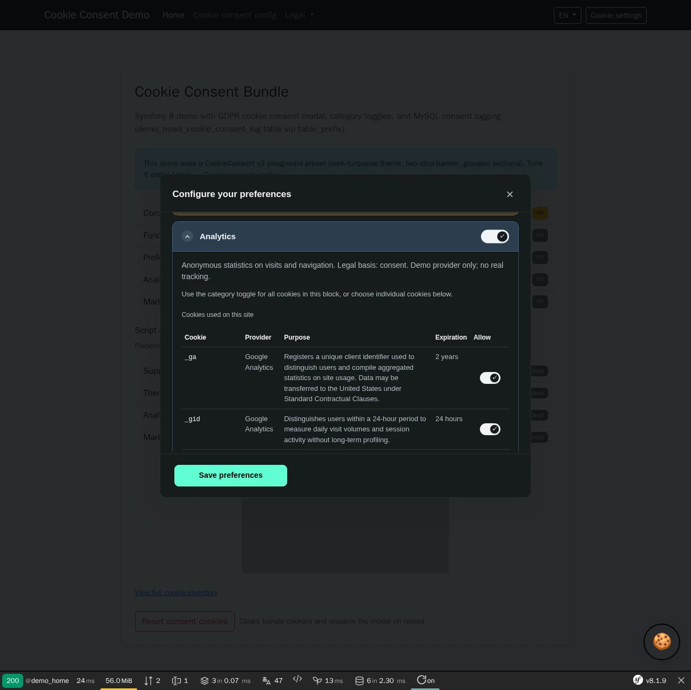
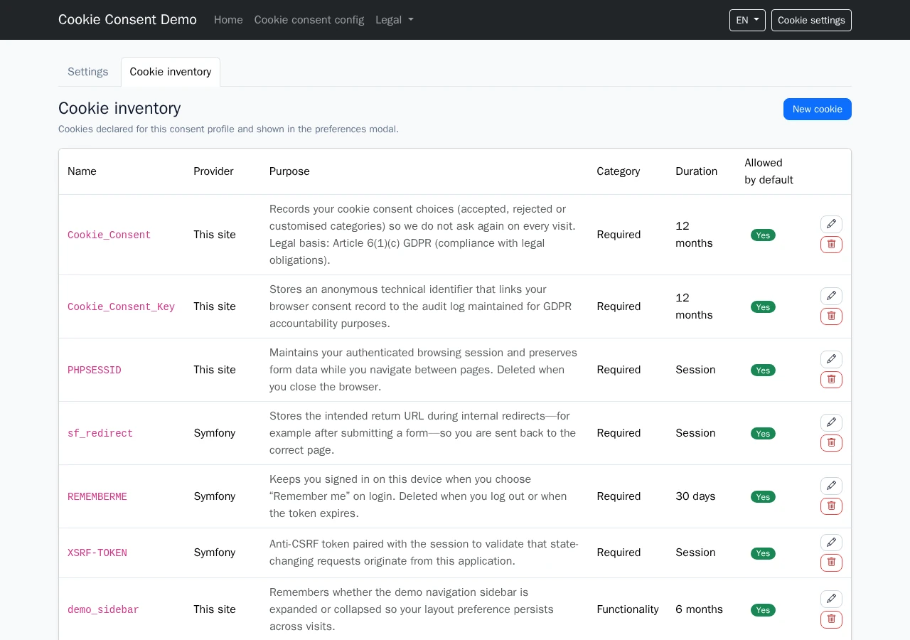
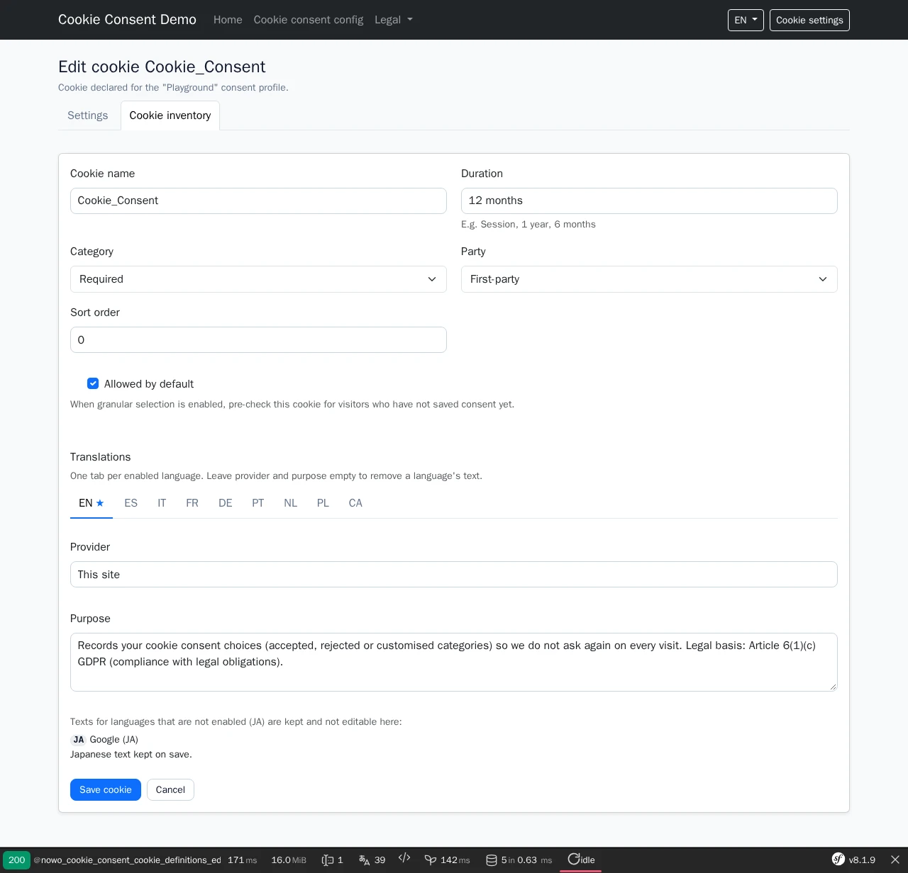
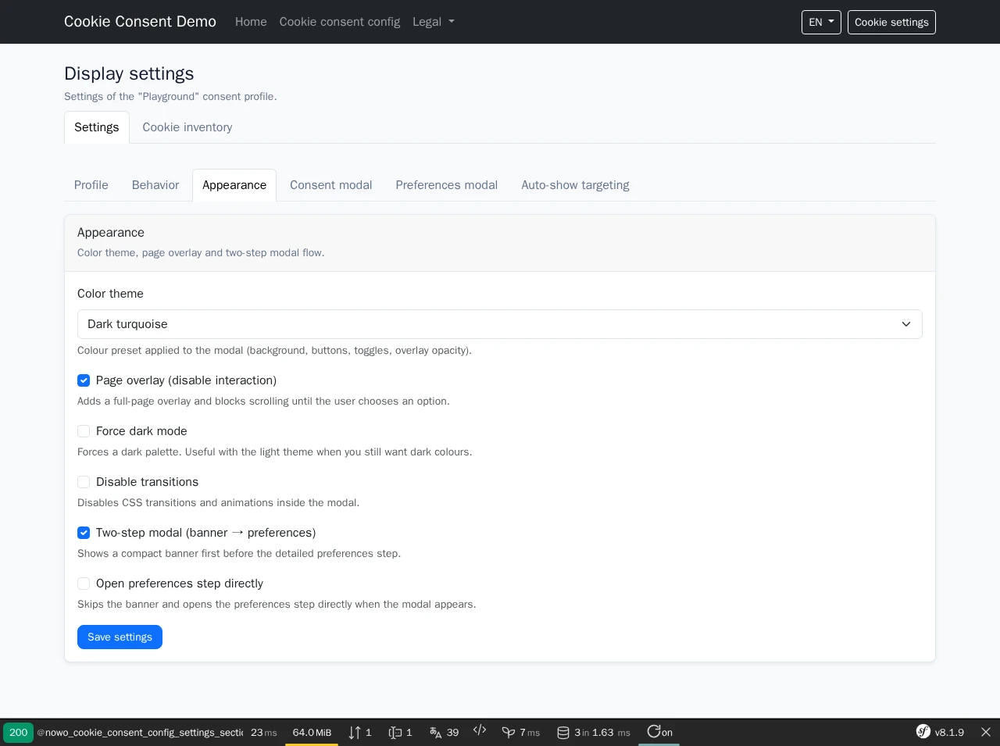
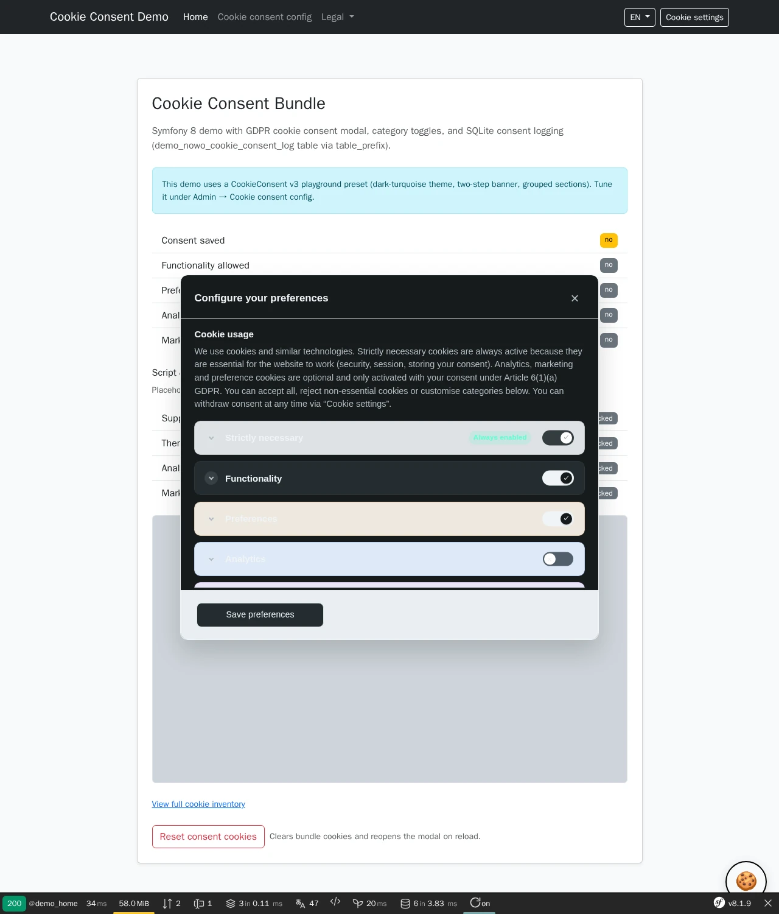
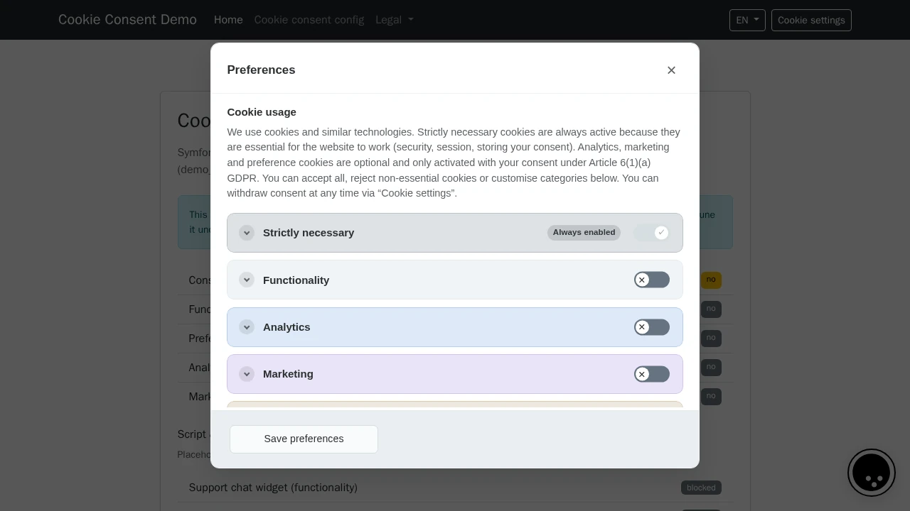

# Usage

## Screenshots

| Overview | Interaction |
|----------|-------------|
|  |  |

Admin pages (UiKit page scaffolds with the demo host theme):

| Cookie inventory (`page/list`) | Cookie definition (`page/form`) | Profile settings (`page/settings`) |
|---|---|---|
|  |  |  |

Regenerate with `make -C demo/symfony8 demo-screenshots` (REQ-DEMO-013).

## Table of contents

- [Screenshots](#screenshots)
- [Embed the modal](#embed-the-modal)
  - [CSP-safe modal CSS](#csp-safe-modal-css)
- [Conditional scripts](#conditional-scripts)
- [Cookie inventory in the modal](#cookie-inventory-in-the-modal)
- [Cookie inventory admin](#cookie-inventory-admin)
- [Profile settings admin (overlay, theme, layout)](#profile-settings-admin-overlay-theme-layout)
- [Preferences bubble icon](#preferences-bubble-icon)
- [AJAX submission](#ajax-submission)
- [Consent logging](#consent-logging)
- [GDPR erasure and export](#gdpr-erasure-and-export)
  - [UserKit bridge](#userkit-bridge)
- [Using it from a DDD / hexagonal application](#using-it-from-a-ddd--hexagonal-application)
  - [Keeping your domain free of the bundle](#keeping-your-domain-free-of-the-bundle)
  - [Ports (since 1.26)](#ports-since-126)
  - [Reacting to a saved consent (since 1.26)](#reacting-to-a-saved-consent-since-126)
  - [Persistence](#persistence)
  - [Standard host or DDD host without Doctrine (1.28)](#standard-host-or-ddd-host-without-doctrine-128)
  - [Consent cookies: standard host and DDD host (1.30)](#consent-cookies-standard-host-and-ddd-host-130)
    - [Standard host](#standard-host)
    - [DDD host](#ddd-host)
  - [Read-only views (1.28)](#read-only-views-128)
  - [Known limitations](#known-limitations)
- [Asking visitors again (re-consent)](#asking-visitors-again-re-consent)
- [Theming the admin pages](#theming-the-admin-pages)
- [Overriding templates (REQ-TWIG-001)](#overriding-templates-req-twig-001)
- [Database profile copy (`nowo_cookie_consent_trans`)](#database-profile-copy-nowo_cookie_consent_trans)
- [Demo](#demo)
  - [Forms (REQ-TWIG-005)](#forms-req-twig-005)

## Embed the modal

**Preferred (no kernel sub-request):** render the modal HTML in the current request via Twig:

```twig

    {{ nowo_cookie_consent_render() }}

```

When the floating preferences bubble is enabled and you only want the modal while consent is missing (or the bubble needs the modal DOM), guard with `should_embed_modal` as well:

```twig

    {{ nowo_cookie_consent_render() }}

```

**Legacy ESI / sub-request** (still supported for `{{ render(path(...)) }}` / ESI caches):

```twig

    {{ render(path('nowo_cookie_consent.show_if_not_set')) }}

```

When the bubble is disabled, the legacy check is equivalent to `not nowo_cookie_consent_is_saved()`.

To omit the consent fragment entirely on authenticated dashboards (no modal HTML, no inventory queries), configure `skip_render_routes` and optionally guard the embed with `nowo_cookie_consent_should_render()`.

`CookieConsentModalRenderer` / `CookieConsentController::show` also return empty output when the main request route is outside `render_routes` (whitelist) or matches `skip_render_routes`, even if the host forgets the Twig guard.

During cold start (before the database schema exists), Site Backup Bundle may set `_nowo_site_backup_schema_exists: false` on the main request. Cookie Consent Bundle then skips consent rendering and Doctrine work; `nowo_cookie_consent_should_render()` returns `false`. See [CONFIGURATION — Cold start / Site Backup](CONFIGURATION.md#cold-start--site-backup).

The bundle detects the locale from the current request (and `Accept-Language` when enabled). You do not need to pass `locale` manually unless you want to force a specific language.

The modal uses Bootstrap 5 markup (or Tailwind when `ui_theme: tailwind`). Include the matching CSS/JS in your layout, or rely on the bundle fallback that toggles `.show` on the modal element.

### CSP-safe modal CSS

When the site CSP uses **style-src nonces**, browsers ignore the `<style>` block that `nowo-consent-modal.js` injects by default. Link the standalone kit stylesheet and mark it:

```twig
<link rel="stylesheet"
      href="{{ asset('nowo-cookie-consent.css', 'nowo_cookie_consent') }}"
      data-nowo-cookie-consent-css>
```

Override chrome with `--nowo-cc-*` custom properties in host CSS. Do not fork the public modal Twig only for skinning.

After upgrading the bundle, run `php bin/console assets:install` so `nowo-consent-modal.js` and `nowo-cookie-consent.css` are published.

## Conditional scripts

Load analytics only when the category is allowed:

```twig

    {# analytics snippet #}

```

When granular selection and cookie inventory are enabled, gate third-party scripts by cookie name in PHP:

```php
if ($cookieChecker->isCookieAllowedByUser('_ga', 'analytics')) {
    // load analytics
}
```

## Cookie inventory in the modal

Enable `use_cookie_inventory: true` and populate definitions via YAML or Doctrine (`CookieDefinition` entities). The preferences modal lists cookies per category with provider, purpose, and duration.

With `granular_cookie_selection`, each optional cookie shows an **Allow** toggle. Set `allowed_by_default` on each definition to control the initial state before the visitor saves consent. It defaults to `false` (since 1.24), so optional cookies start unticked (CJEU Planet49); required cookies are always on.

## Cookie inventory admin

The bundle provides `CookieDefinitionAdminController`, `CookieDefinitionType`, and admin templates built on the UiKit page scaffolds (list + form, REQ-UI-003; see [TEMPLATES.md](TEMPLATES.md)). Register the routes in your application and link from your config admin UI.

The Symfony 8 demo implements a full CRUD at `/demo/admin/cookie-consent-config/{id}/cookies` with locale tabs for translations.

## Profile settings admin (overlay, theme, layout)

When `use_database_config: true`, edit `CookieConsentConfig` profiles with:

- **Forms:** one class per tab under `Nowo\CookieConsentBundle\Form\Settings\` (e.g. `CookieConsentConfigProfileSettingsType`); resolve with `CookieConsentConfigSettingsSection::formType()`
- **Recommended defaults** for new profiles (also the entity defaults from **1.9.0**): consent + preferences modals as **box / wide / bottom / left** with **equal-weight buttons** enabled. Existing DB rows keep their stored values until you change them in Administration → Cookie consent.
- **Controller:** `CookieConsentConfigSettingsAdminController` — `GET/POST /cookie-consent-config/{configId}/settings/{section}`
- **Template:** `@NowoCookieConsentBundle/admin/config/settings.html.twig`

The **Page overlay (disable interaction)** setting (`disablePageInteraction`) dims the page and blocks scrolling until the visitor chooses:

| Default (no overlay) | Page overlay |
|----------------------|--------------|
|  |  |

The admin pages render inside `nowo_ui_kit.layouts.admin` (your layout or a one-file bridge; `nowo_cookie_consent.web_ui.layout_template` overrides it for this bundle only), so they inherit the host chrome without copying list/form templates. See [CONFIGURATION.md — Admin Web UI](CONFIGURATION.md#admin-web-ui). Protect admin routes with `security.access_roles` / host `access_control` ([Admin security](CONFIGURATION.md#admin-security)).

Import bundle routes (`config/routes/nowo_cookie_consent.yaml` → `@NowoCookieConsentBundle/Resources/config/routing.yaml`). Labels use the `NowoCookieConsentBundle` translation domain (`en` and `es` shipped; other locales fall back to English).

Example in your controller:

```php
use Nowo\CookieConsentBundle\Admin\CookieConsentConfigSettingsSection;

$section = CookieConsentConfigSettingsSection::Appearance;
$form = $this->createForm($section->formType(), $config);
```

For a single-page editor (all sections at once), use `CookieConsentConfigFullSettingsType` (or the deprecated `CookieConsentConfigSettingsType` alias). The demos do that with demo-specific label prefixes and route placeholders.

## Preferences bubble icon

When the bubble is enabled, set custom markup in the admin **Bubble icon (HTML/SVG)** field or via `CookieConsentConfig::setPreferencesBubbleIcon()`. SVG and simple HTML (e.g. an emoji in a `<span class="nowo-cookie-consent__preferences-bubble-emoji">`) are supported; dangerous markup is rejected server-side. Leave empty for the default cookie SVG.

## AJAX submission

The bundled `nowo-consent-modal.js` (built from TypeScript via Vite) submits the form via `XMLHttpRequest` and dispatches `nowo-cookie-consent-form-submit-successful` on success.

Before each XHR POST it prepares Symfony CSRF the same way as the Flex `csrf-protection` Stimulus controller (native `submit` never fires on button click): SameOrigin double-submit cookie when the field still holds the cookie-name placeholder, plus a `csrf-token` request header when `framework.csrf_protection.check_header` is enabled. Keep `nowo_cookie_consent.csrf_protection: true`.

## Consent logging

When `use_logger: true`, each submission creates rows in `CookieConsentLog` with anonymized IP addresses (GDPR-friendly).
Since 1.25 each row also records the profile `revision` the visitor answered (`consent_revision`), resolved from the
page the form was shown on (hidden `page_route` field), also with a dedicated `form_action`. That route is what the
browser reports, so it is visitor-controlled: a forged value only changes the `consent_revision` of that visitor's own
log rows, never whether consent is valid.

## GDPR erasure and export

Since the next minor the bundle ships one port per direction for the consent log (`CookieConsentLog`, table
`<prefix>dashboard_cookie_log`). Type-hint the interfaces; plain PHP, no Doctrine or HTTP type in their signatures.

```php
use Nowo\CookieConsentBundle\PersonalData\CookieConsentIpWindow;
use Nowo\CookieConsentBundle\PersonalData\CookieConsentPersonalDataEraserInterface;
use Nowo\CookieConsentBundle\PersonalData\CookieConsentPersonalDataExporterInterface;
use Nowo\CookieConsentBundle\PersonalData\CookieConsentPersonalDataSubject;

$subject = CookieConsentPersonalDataSubject::fromConsentKey($consentKey); // the visitor's Cookie_Consent_Key

// Erasure by IP window only with `personal_data.ip_windows: erase` (ignored otherwise, never exported):
$subject = CookieConsentPersonalDataSubject::of(
    [CookieConsentIpWindow::of('203.0.113.42', $firstSeen, $lastSeen)], // raw or stored (anonymised) IP
    [$consentKey],
);

$export = $exporter->export($subject); // {"decisions": [{cookie_name, allowed, consent_revision, recorded_at}, ...]}
$result = $eraser->erase($subject);    // CookieConsentErasureResult: consentLogs, toArray(), total()
```

**Whose rows.** The bundle stores no user id with a consent. A row belongs to the subject when its
`cookie_consent_key` is one of the subject's keys (`fromConsentKey()`; the key is also in `ConsentSavedEvent`). Keys
are compared byte for byte (no trimming, no case folding); SQL only pre-filters, every row is re-checked in PHP, so
`UserA` never matches `usera` whatever the column collation.

**IP windows (opt-in, erasure only).** With `personal_data.ip_windows: erase`, the eraser also deletes the rows whose
stored IP equals a window's IP with a time inside the window (`fromIpWindow()`; both bounds inclusive, widened by
`ip_window_margin`, default `PT0S`). A raw IP is anonymised exactly like the logger does before comparing
(`203.0.113.42` → `203.0.113.xx`, IPv6 → first 48 bits); `unknown` is rejected. The stored IP is shared by every
visitor of the same /24 (/48) — a CGNAT, an office, a campus — so a window also deletes other people's proof of
consent: keep it off unless you accept that, and keep the windows tight. With the default `off`, the windows of a
subject are ignored (a subject with only windows erases nothing and dispatches no event). **The export never uses IP
windows**, whatever the setting: it would hand other visitors' decisions to the requester (art. 15(4)).

**Erasure.** DBAL `DELETE … WHERE id IN (…)` in batches of 500 on the connection of the entity manager that maps the
consent log (`doctrine.entity_manager`). No entity manager is flushed or cleared. Idempotent: a second run returns 0.
Without an active transaction each batch runs in its own transaction and `CookieConsentPersonalDataErasedEvent`
(subject keys, IP windows, counts, time; scalars only) is dispatched after the last commit. Inside your own transaction
the eraser joins it and the event is **not** dispatched (the bundle cannot know whether you commit): the returned
result is the outcome.

**Export.** By consent key only. Read-only, oldest first, each row once. Never the consent key or the IP.

**Separate entity manager.** When the consent log lives on its own entity manager / connection
(`doctrine.entity_manager`), the eraser commits on that connection on its own, even inside UserKit's run: if a later
eraser fails and UserKit rolls back, the consent rows stay deleted (a partial erasure). Re-running the erasure is safe:
it is idempotent.

**Hosts without Doctrine.** The default ports are removed with the other Doctrine-only services (your own consent store
holds the data); alias the interfaces to your own implementation if you want them.

### UserKit bridge

With `nowo-tech/user-kit-bundle` (>= 1.12) installed, the bundle entities mapped and `personal_data.enabled: true`
(default), the bundle registers:

| UserKit tag | Key | Priority |
|---|---|---|
| `nowo_user_kit.personal_data.eraser` | `cookie_consent_logs` | 110 (before HttpLog's 100 and the host identity eraser) |
| `nowo_user_kit.personal_data.export_provider` | `cookie_consents` | -50 |

The bridge needs to know which consent rows are the user's. Set `personal_data.subject_resolver` to a service
implementing `CookieConsentPersonalDataSubjectResolverInterface`
(`subjectsFor(object $user, ?string $originalIdentifier): list<CookieConsentPersonalDataSubject>`), e.g. returning the
consent keys your app stored per user from `ConsentSavedEvent`. For the erasure only, and only with
`personal_data.ip_windows: erase`, you can instead tag `CookieConsentIpWindowProviderInterface` services
(`ipWindowsFor(object $user, ?string $originalIdentifier): iterable`, autoconfigured; each window widened by
`ip_window_margin`). With `ip_windows: off` (default) the bridge does not use IP windows at all: providers are not
called and the windows of any subject are dropped. The export section always uses consent keys only. The eraser asks
the resolver for the original identifier (`ErasureRequest::identifier()`) and for `context['previous_email']` when it
is a non-empty string, and erases once per distinct subject. **Without a resolver returning consent keys (or opted-in
IP windows) the bridge erases and exports nothing.** Resolvers and providers must keep no state (worker mode).

## Asking visitors again (re-consent)

*Since 1.25 (owner decision JH-L1).* The profile `revision` is a free label. When you save a change to it in the
profile settings (*Behavior*), the form asks **Ask visitors to consent again?** and refuses the save until you answer:

- **No** for minor changes (typos, wording): the label changes, saved consents are kept.
- **Yes** for material changes (new purposes, categories or providers): the profile stores the time of the request
  (`reconsent_required_at`). Every visitor whose consent is older sees the banner again, and until they answer only
  necessary cookies apply (the JS activates no optional script or iframe before they answer); their earlier optional
  choices are not pre-ticked. Their consent cookies are expired on the
  next private response, except `Cookie_Consent_Key`. You can also answer *Yes* without changing the label.

Consents saved before you upgraded to 1.25 are kept until you answer *Yes* once. In templates and PHP, read consent
through the helpers, which already treat an outdated consent as none:

```twig

    {# the visitor consented before the last re-consent request: the banner is open again #}

```

```php
$checker->isConsentOutdated();       // true until the visitor answers again
$checker->isCookieConsentSavedByUser(); // false while outdated
```

From your own code, `$config->requireReconsent(new \DateTimeImmutable())` followed by a flush does the same as *Yes*.

## Using it from a DDD / hexagonal application

CookieConsentBundle is a self-contained bounded context (consent management) plus a presentation layer (modal,
Twig functions, admin pages). It has its own Doctrine entities (`CookieConsentConfig`, `CookieDefinition`,
`CookieConsentLog` and their translations) and never maps or references your entities: no
`resolve_target_entities`, no user relation, no base class or trait to extend.

### Keeping your domain free of the bundle

- Treat it as infrastructure/presentation. Your domain should not import `Nowo\CookieConsentBundle\*`.
- To ask "may I use analytics for this visitor?", define a port in your domain and implement it with
  `CookieCheckerInterface` (default `CookieChecker`), which only reads the request cookies (no database access):

```php
// Domain
interface VisitorConsent
{
    public function allows(string $category): bool;
}

// Infrastructure
final class CookieConsentVisitorConsent implements VisitorConsent
{
    public function __construct(private readonly \Nowo\CookieConsentBundle\Cookie\CookieCheckerInterface $checker) {}

    public function allows(string $category): bool
    {
        return $this->checker->isCookieConsentSavedByUser()
            && $this->checker->isCategoryAllowedByUser($category);
    }
}
```

- `CookieCheckerInterface::isCookieAllowedByUser($cookieName, $category)` and `getGranularPreferences()` cover
  per-cookie consent.
- In templates use `nowo_cookie_consent_is_category_allowed('analytics')`.
- To control who reaches the admin pages, implement `CookieConsentAccessCheckerInterface` and set
  `nowo_cookie_consent.security.access_checker` to your service id.
- In the browser, listen to `nowo-cookie-consent-form-submit-successful` on `document` to react after a save.

### Ports (since 1.26)

The documented API is three interfaces, each aliased to the bundle's default service. Type-hint the interface; alias
it to your own service to replace one part:

| Interface | Default | Purpose |
| --- | --- | --- |
| `Nowo\CookieConsentBundle\Cookie\CookieCheckerInterface` | `CookieChecker` | Read the visitor's consent from the request cookies. |
| `Nowo\CookieConsentBundle\Cookie\ConsentCookieWriterInterface` (1.30) | `CookieHandler` | Decide which consent cookies to write / expire; returns a `ConsentCookieJar` (no `Request` / `Response`). |
| `Nowo\CookieConsentBundle\Cookie\CookieHandlerInterface` (deprecated 1.30, removed in 2.0) | `CookieHandler` | Write / expire the consent cookies on the response. |
| `Nowo\CookieConsentBundle\Cookie\CookieLoggerInterface` | `CookieLogger` | Store the proof of consent (`use_logger: true`). |

```yaml
# config/services.yaml: keep the proof of consent in your own audit store
services:
    Nowo\CookieConsentBundle\Cookie\CookieLoggerInterface: '@App\Infrastructure\Consent\AuditConsentLog'
```

A `CookieLoggerInterface` implementation must have stored the rows durably when `log()` returns, and throw when it
could not: the bundle then dispatches no `ConsentSavedEvent`.

### Reacting to a saved consent (since 1.26)

`Nowo\CookieConsentBundle\Event\ConsentSavedEvent` (event name = class name) is dispatched once per saved consent,
after the cookies are set on the response and, with `use_logger: true`, after the consent log rows are flushed. If the
log fails, no event is dispatched. The payload holds only scalars: `consentKey` (the anonymous key of the visitor's log
rows), `categories` (`array<string, bool>`, without `required`), `granularCookies` (`array<string, bool>`), `logged`
and `occurredAt`. No IP address, no request, no entity.

```php
#[AsEventListener]
final class ConsentSavedListener
{
    public function __construct(private readonly RecordVisitorConsent $record) {} // your application port

    public function __invoke(ConsentSavedEvent $event): void
    {
        ($this->record)($event->consentKey, $event->isCategoryAllowed('analytics'), $event->occurredAt);
    }
}
```

The listener runs during `kernel.response`; keep it short or hand the work to Messenger.

### Persistence

- The bundle tables (`dashboard_cookie_*`, prefixed by `doctrine.table_prefix`) live on the **default** entity
  manager unless `doctrine.entity_manager` names another one (1.27). In that case they are mapped on that manager
  only, even when your default manager uses `auto_mapping`, and every bundle service (logger, repositories, schema
  probe, admin) uses it. Include them in your migrations like any third-party schema.
- Saving a consent never flushes or resets an entity manager (1.27): the rows are written with DBAL inserts in one
  transaction on that manager's connection, so your unit of work is left untouched.

### Standard host or DDD host without Doctrine (1.28)

- **Standard path (default, nothing to configure).** DoctrineBundle registered: the bundle maps its entities (on the
  default manager or `doctrine.entity_manager`), logs consents with DBAL (`use_logger: true`), and can read profiles
  and the cookie inventory from its tables (`use_database_config`, admin pages).
- **DDD path (opt-in).** No DoctrineBundle: the configuration, the modal copy and the cookie inventory come from the
  bundle configuration (YAML, `%env()%`), and the proof of consent goes to your own store. The bundle registers no
  entity mapping, no repository and no Doctrine listener; the admin routes answer 404.

```yaml
# config/packages/nowo_cookie_consent.yaml — config/bundles.php has no DoctrineBundle
nowo_cookie_consent:
    use_logger: true            # your CookieLoggerInterface below; false = no proof of consent is kept
    use_database_config: false  # required without Doctrine
    use_cookie_inventory: true
    cookie_inventory:
        - { name: _ga, category: analytics, duration: '2 years', translations: { en: { provider: Google, purpose: Statistics } } }

# config/services.yaml
services:
    Nowo\CookieConsentBundle\Cookie\CookieLoggerInterface: '@App\Infrastructure\Consent\AuditConsentLog'
```

Without Doctrine the build fails with an explicit message for `use_database_config: true`, and for `use_logger: true`
when `CookieLoggerInterface` is still the bundle's own logger. With `use_logger: false` and no alias, a
`NullCookieLogger` is used. Your logger is a shared service: in a kept-alive FrankenPHP worker keep no visitor state in
it (`tests/Integration/Ddd/HostWithoutDoctrineKernelTest.php` serves 600 requests for two visitors through
`http_kernel` without the services resetter).

### Consent cookies: standard host and DDD host (1.30)

The bundle writes the consent cookies (`Cookie_Consent`, `Cookie_Consent_Key`, `Cookie_Category_*`,
`Cookie_Consent_Granular`) in its own `kernel.response` listeners. Which cookies to write or expire is decided by a
framework-free port, `ConsentCookieWriterInterface`: it takes scalars and a `ConsentRequestCookies` value object (the
cookie names of the request) and returns a `ConsentCookieJar` of `ConsentCookie` value objects. The bundle then writes
the jar on the response (`Http\ConsentCookieJarApplier`). No `Request`, `Response` or other Symfony component type
crosses the port.

#### Standard host

Nothing to configure. `ConsentCookieWriterInterface` is aliased to `nowo_cookie_consent.cookie_writer` and the
deprecated `CookieHandlerInterface` to `CookieHandler` (two definitions of the same class), and the `Set-Cookie` headers are the same as in 1.29, byte for byte: path `/`, no domain, `Secure`,
`SameSite=Lax`, `HttpOnly` from `nowo_cookie_consent.http_only`, one year expiry, not raw (covered by
`tests/Unit/Http/ConsentCookieEquivalenceTest.php`).

#### DDD host

Alias the port to your own writer; it never sees an HTTP object, and the bundle applies the jar for you:

```php
use Nowo\CookieConsentBundle\Cookie\ConsentCookie;
use Nowo\CookieConsentBundle\Cookie\ConsentCookieJar;
use Nowo\CookieConsentBundle\Cookie\ConsentCookieWriterInterface;
use Nowo\CookieConsentBundle\Cookie\ConsentRequestCookies;

final class ConsentCookies implements ConsentCookieWriterInterface
{
    public function __construct(private readonly \Psr\Clock\ClockInterface $clock) {}

    public function consentCookies(array $categories, string $key, array $granularCookies = []): ConsentCookieJar
    {
        return (new ConsentCookieJar())
            ->with(ConsentCookie::persistent('Cookie_Consent_Key', $key, $this->clock->now()->add(new \DateInterval('P1Y')), true));
    }

    public function expiredConsentCookies(ConsentRequestCookies $requestCookies): ConsentCookieJar
    {
        return $requestCookies->has('Cookie_Consent')
            ? (new ConsentCookieJar())->with(ConsentCookie::expired('Cookie_Consent', true))
            : new ConsentCookieJar();
    }
}
```

```yaml
# config/services.yaml
services:
    Nowo\CookieConsentBundle\Cookie\ConsentCookieWriterInterface: '@App\Infrastructure\Consent\ConsentCookies'
```

`CookieChecker` still reads the bundle's cookie names, so a writer that renames them also needs its own
`CookieCheckerInterface`. Keep the writer stateless: in a kept-alive FrankenPHP worker the same instance serves every
visitor (`tests/Integration/Ddd/HostCookieWriterKernelTest.php`: 400 requests for two visitors, no services resetter).

Which port the bundle calls is decided once, when the container is built (`ConsentCookieWriterPass`, after decoration):
a service aliased to `ConsentCookieWriterInterface` (or a decorator of `nowo_cookie_consent.cookie_writer`) first;
otherwise the bundle writer when `CookieHandlerInterface` is still the bundle's `CookieHandler`; otherwise the
`CookieHandlerInterface` service when its class also implements the new port; otherwise the deprecated
`CookieHandlerInterface::save()` / `clear()` methods, as in 1.29. That last case covers a decorator of `CookieHandler`
or of `CookieHandlerInterface` (`#[AsDecorator]`), a replaced class and a `CookieHandler` subclass (an overridden
`saveCookie()` still runs); it reports one `E_USER_DEPRECATED` notice at container build, never per request. See
[UPGRADING](UPGRADING.md#unreleased).

### Read-only views (1.28)

Host code that needs the resolved profile or the cookie table reads scalars, never the bundle entities:

- `ResolvedCookieConsentConfig::view()` returns a `Config\ConsentProfileView` (`id`, `name`, `revision`,
  `isDefault`, `priority`, `autoShow`, `routePatterns`, `locale`, `translationMessages`, `reconsentRequiredAt`);
  `getConfigId()` gives the id alone.
- `CookieInventoryProvider::viewsForLocale(?ResolvedCookieConsentConfig $resolved, string $locale)` returns
  `list<Config\CookieDefinitionView>` (`name`, `provider`, `purpose`, `duration`, `category`, `type`,
  `allowedByDefault`), from the profile's rows or the YAML inventory.

### Known limitations

- With DoctrineBundle registered, the entity mapping is registered even when `use_logger` and `use_database_config`
  are both `false` (BC: unmapping it would show the tables as a DROP in schema diffs); 2.0 maps them only when used.
- The admin pages still flush the bundle's entity manager when you save a definition or a profile (use a dedicated
  `doctrine.entity_manager` to keep that away from your own unit of work).
- `ResolvedCookieConsentConfig::getConfig()` / `getTranslation()` and `CookieInventoryProvider::listForLocale()` still
  take or return the bundle entities (the bundle uses them internally); prefer the views above.
- There is no port for the profile source itself: a host provides profiles through YAML or the bundle tables.

## Theming the admin pages

Since **1.16** the admin pages (cookie inventory, cookie definition form, profile settings) extend the **UiKit page
scaffolds** (REQ-UI-003). Pick the lightest layer that does the job:

1. **UiKit layout** — `nowo_ui_kit.layouts.admin`: your shell (sidebar, header) for every Nowo bundle;
   `nowo_cookie_consent.web_ui.layout_template` only when this bundle must differ.
2. **UiKit theme** — `nowo_ui_kit.theme` (`tokens`, `classes`, `attributes`, `partials`) themes every list / form /
   settings page of every bundle; `theme.bundles.NowoCookieConsentBundle` holds exceptions for this bundle only.
   Slot vocabulary: UiKit `docs/THEME_SLOTS.md`.
3. **Scaffold override** — `templates/bundles/NowoUiKitBundle/page/list.html.twig` (or `form`, `settings`) re-skins
   that view type for every bundle.
4. **Per-page template** — `nowo_cookie_consent.web_ui.templates.<page>` with a thin template that extends
   `@!NowoCookieConsentBundle/admin/…` and overrides a data block ([TEMPLATES.md](TEMPLATES.md#per-page-overrides)).

```yaml
nowo_ui_kit:
    css_framework: tailwind
    layouts:
        admin: 'layouts/admin.html.twig'
    theme:
        classes:
            table: 'data-table'
            btn_primary: 'btn-primary'
        attributes:
            table_wrap: { data-testid: data-table }
        bundles:
            NowoCookieConsentBundle:
                classes: { table: 'data-table data-table--dense' }
```

The 1.13–1.15 `web_ui.chrome` map still works for one minor version: it is **deprecated** and bridged into
`nowo_ui_kit.theme.bundles.NowoCookieConsentBundle` (mapping table in
[UPGRADING — Template contract](UPGRADING.md#template-contract-116)).

**Blocks.** Data blocks of the scaffolds (`nowo_ui_list_row`, `nowo_ui_form_body`, `nowo_ui_settings_section`). The
Settings / Cookie inventory tabs are the page header's area navigation (`page.header.tabs`, UiKit `AreaNav`), also
available to other bundles through `nowo_ui_area_nav('cookie_consent', {configId: …})`. The 1.x
`nowo_cookie_consent_admin_*` chrome blocks (page header, table wrapper, pagination, form actions…) are gone: those
regions belong to the scaffold now.

## Overriding templates (REQ-TWIG-001)

The bundle registers the Twig namespace **`@NowoCookieConsentBundle/`**. Application files under **`templates/bundles/NowoCookieConsentBundle/`** **always win** over the copies inside the package (`TwigPathsPass` prepends that directory when it exists, then adds the bundle views path).

**Freeze rule:** a full-file override hides vendor updates for that `<subpath>` until you delete or manually merge it. Prefer surgical overrides (a single partial), a block fork via `@!NowoCookieConsentBundle/…`, or config such as **`nowo_ui_kit.theme`** / **`nowo_cookie_consent.web_ui.templates`** ([Theming the admin pages](#theming-the-admin-pages)) for upgrade-safe customisation — see [CONFIGURATION.md — Admin Web UI](CONFIGURATION.md#admin-web-ui).

**Procedure**

1. Identify the `<subpath>` from the table below (path relative to `src/Resources/views/`).
2. Create in your application: `templates/bundles/NowoCookieConsentBundle/<subpath>` (same relative path and filename).
3. Clear the cache in dev if needed: `php bin/console cache:clear`.

Example — override the Bootstrap modal shell:

```text
templates/bundles/NowoCookieConsentBundle/cookie_consent.html.twig
```

Controllers and Twig use logical names such as `@NowoCookieConsentBundle/cookie_consent.html.twig`, never absolute filesystem paths.

**Overridable templates**

| Subpath | Purpose |
| --- | --- |
| `cookie_consent.html.twig` | Main consent modal (Bootstrap theme) |
| `cookie_consent.tailwind.html.twig` | Main consent modal (Tailwind theme) |
| `form/cookie_consent_theme.html.twig` | Symfony form theme for consent fields (Bootstrap) |
| `form/cookie_consent_theme.tailwind.html.twig` | Form theme (Tailwind) |
| `cookie_consent_preferences_bubble.html.twig` | Floating “cookie settings” bubble button |
| `_preferences_bubble_icon_default.html.twig` | Default cookie SVG for the preferences bubble |
| `cookie_consent_manage_link.html.twig` | Inline link to reopen preferences |
| `_category_cookie_table.html.twig` | Per-category cookie inventory table (granular mode) |
| `_preference_sections.html.twig` | Preferences step category blocks |
| `_preferences_intro.html.twig` | Intro text on the preferences step |
| `_intro_more.html.twig` | 1.23: "Show more" toggle of the first-layer intro on phones (`aria-controls="nowoCookieConsentIntro"`) |
| `_diagnostics_script.html.twig` | Optional diagnostics script partial |
| `admin/_admin_area_nav.html.twig` | **Deprecated** — Settings / Cookie inventory area tabs for 1.x host templates (the pages use `page.header.tabs`) |
| `admin/cookie_definition/index.html.twig` | Cookie inventory list (`page/list`; prefer `web_ui.templates.cookie_definition_index`) |
| `admin/cookie_definition/form.html.twig` | Create/edit cookie definition (`page/form`; prefer `web_ui.templates.cookie_definition_form`) |
| `admin/config/settings.html.twig` | Profile settings sections (`page/settings`; prefer `web_ui.templates.settings`) |

Theme selection follows `ui_theme` (`bootstrap` or `tailwind`); override the modal and form theme rows that match your active theme. See also [CONFIGURATION.md — UI theme](CONFIGURATION.md#ui-theme).

## Database profile copy (`nowo_cookie_consent_trans`)

With `use_database_config: true`, print the profile texts of the current request with
`nowo_cookie_consent_trans('<message id>', display_config ?? null)` (e.g. `nowo_cookie_consent.title`, `.intro`,
`.read_more`, `.privacy_route`). It falls back to the `NowoCookieConsentBundle` translation domain; plain `|trans`
only returns the YAML translations.

This helper is required for FrankenPHP worker mode when the kernel is not reset between requests: the bundle no longer
calls `Translator::addResource()` per request. See [FRANKENPHP-WORKER-AUDIT.md](FRANKENPHP-WORKER-AUDIT.md) and
[UPGRADING — To 1.10.0](UPGRADING.md#to-1100-frankenphp-worker-remediation).

## Demo

See `demo/symfony8/` for a FrankenPHP demo application (port **8014**). Tailwind variant: `demo/symfony8-tailwind/` (port **8015**).

Seed sample inventory: `php bin/console demo:seed-cookie-definitions --if-empty`

### Forms (REQ-TWIG-005)

Bundle views and both demos render every form through Symfony Form Types (Form Kit) with `form_start` / the child loop / `form_end`. The demo's CSRF-only buttons (reset consent, delete cookie definition, delete profile copy, delete profile) use FormKit's `CsrfOnlyType` (via `CsrfOnlyFormFactory`, flat `_token`, same token ids) and the controllers validate the submitted Form:

```twig
{{ form_start(reset_form, {attr: {class: 'd-flex gap-2'}}) }}
    
        
            {{ form_row(child) }}
        
    
    <button type="submit" class="btn btn-outline-danger">…</button>
{{ form_end(reset_form) }}
```

Host templates and demos **must not** reintroduce raw `<form>`, `<input>`, `<textarea>` or `<select>` markup. `make check-no-raw-html-form` (part of `release-check`) enforces it; the only allowlisted files are the two form themes (`form/cookie_consent_theme*.html.twig`), which implement Symfony's `checkbox_widget` block.
