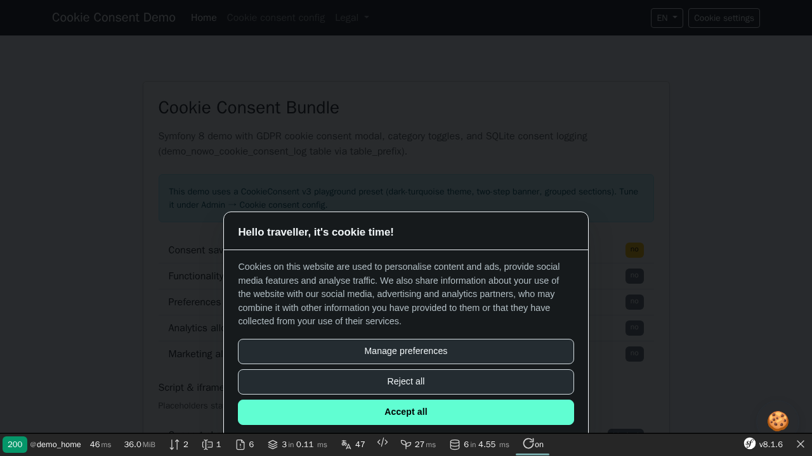
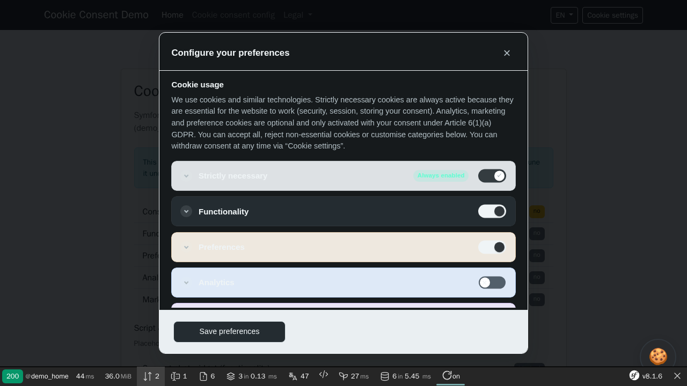

# Usage

## Screenshots

| Overview | Interaction |
|----------|-------------|
|  |  |

Regenerate with `make -C demo/symfony8 demo-screenshots` (REQ-DEMO-013).

## Table of contents

- [Screenshots](#screenshots)

- [Embed the modal](#embed-the-modal)
- [Conditional scripts](#conditional-scripts)
- [Cookie inventory in the modal](#cookie-inventory-in-the-modal)
- [Cookie inventory admin](#cookie-inventory-admin)
- [Profile settings admin (overlay, theme, layout)](#profile-settings-admin-overlay-theme-layout)
- [Preferences bubble icon](#preferences-bubble-icon)
- [AJAX submission](#ajax-submission)
- [Consent logging](#consent-logging)
- [Customising the admin chrome](#customising-the-admin-chrome)
- [Overriding templates (REQ-TWIG-001)](#overriding-templates-req-twig-001)
- [Database profile copy (`nowo_cookie_consent_trans`)](#database-profile-copy-nowo_cookie_consent_trans)
- [Demo](#demo)

## Embed the modal

**Preferred (no kernel sub-request):** render the modal HTML in the current request via Twig:

```twig

    {{ nowo_cookie_consent_render() }}

```

When the floating preferences bubble is enabled and you only want the modal while consent is missing (or the bubble needs the modal DOM), guard with `should_embed_modal` as well:

```twig

    {{ nowo_cookie_consent_render() }}

```

**Legacy ESI / sub-request** (still supported for `{{ render(path(...)) }}` / ESI caches):

```twig

    {{ render(path('nowo_cookie_consent.show_if_not_set')) }}

```

When the bubble is disabled, the legacy check is equivalent to `not nowo_cookie_consent_is_saved()`.

To omit the consent fragment entirely on authenticated dashboards (no modal HTML, no inventory queries), configure `skip_render_routes` and optionally guard the embed with `nowo_cookie_consent_should_render()`.

`CookieConsentModalRenderer` / `CookieConsentController::show` also return empty output when the main request route is outside `render_routes` (whitelist) or matches `skip_render_routes`, even if the host forgets the Twig guard.

During cold start (before the database schema exists), Site Backup Bundle may set `_nowo_site_backup_schema_exists: false` on the main request. Cookie Consent Bundle then skips consent rendering and Doctrine work; `nowo_cookie_consent_should_render()` returns `false`. See [CONFIGURATION — Cold start / Site Backup](CONFIGURATION.md#cold-start--site-backup).

The bundle detects the locale from the current request (and `Accept-Language` when enabled). You do not need to pass `locale` manually unless you want to force a specific language.

The modal uses Bootstrap 5 markup (or Tailwind when `ui_theme: tailwind`). Include the matching CSS/JS in your layout, or rely on the bundle fallback that toggles `.show` on the modal element.

### CSP-safe modal CSS

When the site CSP uses **style-src nonces**, browsers ignore the `<style>` block that `nowo-consent-modal.js` injects by default. Link the standalone kit stylesheet and mark it:

```twig
<link rel="stylesheet"
      href="{{ asset('nowo-cookie-consent.css', 'nowo_cookie_consent') }}"
      data-nowo-cookie-consent-css>
```

Override chrome with `--nowo-cc-*` custom properties in host CSS. Do not fork the public modal Twig only for skinning.

After upgrading the bundle, run `php bin/console assets:install` so `nowo-consent-modal.js` and `nowo-cookie-consent.css` are published.

## Conditional scripts

Load analytics only when the category is allowed:

```twig

    {# analytics snippet #}

```

When granular selection and cookie inventory are enabled, gate third-party scripts by cookie name in PHP:

```php
if ($cookieChecker->isCookieAllowedByUser('_ga', 'analytics')) {
    // load analytics
}
```

## Cookie inventory in the modal

Enable `use_cookie_inventory: true` and populate definitions via YAML or Doctrine (`CookieDefinition` entities). The preferences modal lists cookies per category with provider, purpose, and duration.

With `granular_cookie_selection`, each optional cookie shows an **Allow** toggle. Set `allowed_by_default` on each definition to control the initial state before the visitor saves consent.

## Cookie inventory admin

The bundle provides `CookieDefinitionAdminController`, `CookieDefinitionType`, and Bootstrap admin templates. Register the routes in your application and link from your config admin UI.

The Symfony 8 demo implements a full CRUD at `/demo/admin/cookie-consent-config/{id}/cookies` with locale tabs for translations.

## Profile settings admin (overlay, theme, layout)

When `use_database_config: true`, edit `CookieConsentConfig` profiles with:

- **Forms:** one class per tab under `Nowo\CookieConsentBundle\Form\Settings\` (e.g. `CookieConsentConfigProfileSettingsType`); resolve with `CookieConsentConfigSettingsSection::formType()`
- **Recommended defaults** for new profiles (also the entity defaults from **1.9.0**): consent + preferences modals as **box / wide / bottom / left** with **equal-weight buttons** enabled. Existing DB rows keep their stored values until you change them in Administration → Cookie consent.
- **Controller:** `CookieConsentConfigSettingsAdminController` — `GET/POST /cookie-consent-config/{configId}/settings/{section}`
- **Template:** `@NowoCookieConsentBundle/admin/config/settings.html.twig`

Set `nowo_cookie_consent.web_ui.layout_template` to your project layout (or a one-file bridge) so admin pages inherit host chrome without copying list/form templates. See [CONFIGURATION.md — Admin Web UI](CONFIGURATION.md#admin-web-ui). Protect admin routes with `security.access_roles` / host `access_control` ([Admin security](CONFIGURATION.md#admin-security)).

Import bundle routes (`config/routes/nowo_cookie_consent.yaml` → `@NowoCookieConsentBundle/Resources/config/routing.yaml`). Labels use the `NowoCookieConsentBundle` translation domain (`en` and `es` shipped; other locales fall back to English).

Example in your controller:

```php
use Nowo\CookieConsentBundle\Admin\CookieConsentConfigSettingsSection;

$section = CookieConsentConfigSettingsSection::Appearance;
$form = $this->createForm($section->formType(), $config);
```

For a single-page editor (all sections at once), use `CookieConsentConfigFullSettingsType` (or the deprecated `CookieConsentConfigSettingsType` alias). The demos do that with demo-specific label prefixes and route placeholders.

## Preferences bubble icon

When the bubble is enabled, set custom markup in the admin **Bubble icon (HTML/SVG)** field or via `CookieConsentConfig::setPreferencesBubbleIcon()`. SVG and simple HTML (e.g. an emoji in a `<span class="nowo-cookie-consent__preferences-bubble-emoji">`) are supported; dangerous markup is rejected server-side. Leave empty for the default cookie SVG.

## AJAX submission

The bundled `nowo-consent-modal.js` (built from TypeScript via Vite) submits the form via `XMLHttpRequest` and dispatches `nowo-cookie-consent-form-submit-successful` on success.

Before each XHR POST it prepares Symfony CSRF the same way as the Flex `csrf-protection` Stimulus controller (native `submit` never fires on button click): SameOrigin double-submit cookie when the field still holds the cookie-name placeholder, plus a `csrf-token` request header when `framework.csrf_protection.check_header` is enabled. Keep `nowo_cookie_consent.csrf_protection: true`.

## Consent logging

When `use_logger: true`, each submission creates rows in `CookieConsentLog` with anonymized IP addresses (GDPR-friendly).

## Customising the admin chrome

Since **1.13.0** the admin Web UI (cookie inventory list/form, profile settings) exposes chrome hooks so hosts can match their design system **without copying pages**. Pick the lightest layer that does the job:

1. **`web_ui.layout_template`** — your shell (sidebar, header, page title). Unchanged.
2. **`web_ui.chrome`** — classes, attributes, partial paths, heading tag, row-action display (config only, upgrade-safe).
3. **Block override** — a thin fork that extends the shipped page through `@!NowoCookieConsentBundle/…` and overrides one `nowo_cookie_consent_admin_*` block.
4. **Full override** under `templates/bundles/NowoCookieConsentBundle/` — last resort (freezes the page).

Without `web_ui.chrome` the output is the 1.12.0 markup (golden-tested).

### Class map (`web_ui.chrome.classes`)

Every key replaces the default class string of one element. `~` (null) on a button/pagination key means "UiKit macro for `web_ui.css_framework`" (the default). Unknown keys fail at compile time.

| Key | Default | Element |
| --- | --- | --- |
| `page_header` | `nowo-ui-page-header d-flex justify-content-between align-items-center mb-4` | List page header (title + intro + create button) |
| `page_header_form` | `nowo-ui-page-header mb-4` | Form page header |
| `page_title` / `page_intro` | `h3 mb-1` / `text-muted mb-0` | In-page title and lead |
| `area_nav` / `section_tabs` | `nowo-ui-tabs nowo-ui-tabs--area mb-3` / `nowo-ui-tabs nowo-ui-tabs--sections mb-4` | Tab strip wrapper (`nav_class` for the tabs partial) |
| `tab_list` / `tab_item` / `tab_item_active` | `nowo-ui-tabs__list` / `nowo-ui-tabs__item` / `is-active` | Default tabs partial |
| `table_panel` | `nowo-ui-table-wrap card shadow-sm` | Wrapper around the table |
| `table_wrap` / `table` | `table-responsive` / `table table-striped mb-0 align-middle nowo-ui-table` | Table scroll wrapper and `<table>` |
| `table_muted_cell` / `table_actions_cell` / `empty_cell` | `small text-secondary` / `text-end` / `text-center text-muted py-4` | Purpose cell, actions column, empty state cell |
| `form_panel` / `form_panel_body` | `card shadow-sm nowo-ui-form-wrap` / `card-body` | Cookie form panel (empty body class = no inner `div`) |
| `settings_panel` / `settings_panel_body` | `card shadow-sm nowo-ui-form-wrap` / `card-body p-4` | Settings panel |
| `form` | *(empty)* | `class` on `<form>` |
| `form_actions` / `settings_actions` | `d-flex gap-2 mt-3` / `nowo-ui-form-actions mt-4 pt-3 border-top` | Submit row |
| `section_title` / `section_lead` | `h6 text-uppercase text-muted fw-semibold mb-1` / `small text-muted mb-3` | Settings section heading |
| `button_primary` / `button_secondary` | `~` → `ui.btn('primary'\|'secondary')` | Create / save / cancel (marker classes `nowo-ui-action-*` are always appended) |
| `confirm_cancel` / `confirm_delete` | `~` → `ui.btn(…, 'sm')` | Delete confirm dialog buttons |
| `pagination` / `pagination_summary` / `pagination_actions` / `pagination_button` | `~` → `ui.pagination_wrap ~ ' mt-3'` / `text-muted small` / `~` → `ui.row_actions` / `~` → `ui.btn('secondary', 'sm')` | Default pagination partial |

### Attributes, partials and options

```yaml
nowo_cookie_consent:
    web_ui:
        layout_template: 'admin/_cookie_consent_layout.html.twig'
        css_framework: tailwind
        chrome:
            page_title_tag: h2            # h1 (default) … h6 | none — use h2/none when your layout renders the h1
            row_actions_display: inherit  # text (default) | icon | icon_text | inherit (= nowo_ui_kit.row_actions_display)
            classes:
                page_header: 'toolbar'
                table_panel: 'panel nowo-ui-table-wrap'
                table: 'data-table'
                form_panel: 'panel nowo-ui-form-wrap'
                form_panel_body: ''        # drop the inner card-body div
                settings_panel: 'panel nowo-ui-form-wrap'
                settings_panel_body: ''
                form: 'nowo-ui-form nowo-ui-form--stack'
                button_primary: 'btn-primary'
                button_secondary: 'btn-ghost'
                area_nav: 'mb-4 nowo-ui-tabs--area'
                section_tabs: 'mb-6 nowo-ui-tabs--sections'
            attributes:                    # same element keys as classes
                table_panel: { data-testid: cookie-consent-definitions-table }
                settings_panel: { data-testid: cookie-consent-settings-form }
            templates:
                tabs: 'shared/_tabs.html.twig'           # default @NowoCookieConsentBundle/admin/_tabs.html.twig
                pagination: 'shared/_pagination.html.twig' # default @NowoCookieConsentBundle/admin/_pagination.html.twig
                form_theme: ~                            # default bootstrap_5_layout.html.twig; ~ = your app form theme
                form_fields: 'form/_fields.html.twig'    # ~ (default) = bundle loop of form_row()
                styles_after: 'admin/_remaps.html.twig'  # included after nowo-ui.css in admin/base.html.twig
```

**Partial contracts**

| Partial | Variables |
| --- | --- |
| `templates.tabs` | `variant` (`area` \| `sections`), `aria_label` (translated), `items` (`[{label, href, current}]`), `nav_class`, `list_class`, `item_class`, `active_class`, `attr` (hash, includes `data-turbo: 'false'` + `attributes.area_nav` / `attributes.section_tabs`), `framework`. Rendered with `only`. |
| `templates.pagination` | `page`, `pages`, `total`, `page_size`, `item_count`, `framework`, plus the page context (`config`, `definitions`, …). |
| `templates.form_fields` | `form` (rendered with `only`); `form_end()` renders anything left (CSRF token). |
| `templates.styles_after` | Page context; output lands inside `` after the UiKit stylesheet. |

### Blocks (thin forks)

`@!NowoCookieConsentBundle/…` always resolves to the shipped templates (even when you override the same path), so a fork can stay a few lines:

```twig
{# templates/bundles/NowoCookieConsentBundle/admin/cookie_definition/index.html.twig #}



    <a class="btn-primary" href="{{ path('nowo_cookie_consent_cookie_definitions_new', {configId: config.id}) }}">
        {{ 'nowo_cookie_consent.admin.cookie_definition.new'|trans({}, 'NowoCookieConsentBundle') }}
    </a>

```

| Template | Blocks |
| --- | --- |
| `admin/base.html.twig` | `nowo_ui_flashes`, `nowo_ui_styles`, `nowo_cookie_consent_admin_styles_after`, `nowo_ui_scripts` |
| `admin/cookie_definition/index.html.twig` | `…_area_nav`, `…_page_header`, `…_page_title`, `…_page_intro`, `…_page_actions`, `…_table_wrapper`, `…_pagination` |
| `admin/cookie_definition/_table.html.twig` | `…_table_head`, `…_row_actions`, `…_empty_state` (fork `_table` itself and extend `@!…/_table.html.twig`) |
| `admin/cookie_definition/form.html.twig` | `…_area_nav`, `…_page_header`, `…_page_title`, `…_page_intro`, `…_form_wrapper`, `…_form_body`, `…_form_actions` |
| `admin/config/settings.html.twig` | `…_area_nav`, `…_section_tabs`, `…_settings_section`, `…_section_header`, `…_form_body`, `…_form_actions` |

(`…` = `nowo_cookie_consent_admin`.) Blocks only reorganise chrome: keep route names, `delete_forms` (CSRF), confirm ids (`delete-cookie-definition-{id}`) and `nowo-ui-action-*` marker classes when you override them.

## Overriding templates (REQ-TWIG-001)

The bundle registers the Twig namespace **`@NowoCookieConsentBundle/`**. Application files under **`templates/bundles/NowoCookieConsentBundle/`** **always win** over the copies inside the package (`TwigPathsPass` prepends that directory when it exists, then adds the bundle views path).

**Freeze rule:** a full-file override hides vendor updates for that `<subpath>` until you delete or manually merge it. Prefer surgical overrides (a single partial), a block fork via `@!NowoCookieConsentBundle/…`, or config such as **`nowo_cookie_consent.web_ui.layout_template`** / **`web_ui.chrome`** ([Customising the admin chrome](#customising-the-admin-chrome)) for upgrade-safe customisation — see [CONFIGURATION.md — Admin Web UI](CONFIGURATION.md#admin-web-ui).

**Procedure**

1. Identify the `<subpath>` from the table below (path relative to `src/Resources/views/`).
2. Create in your application: `templates/bundles/NowoCookieConsentBundle/<subpath>` (same relative path and filename).
3. Clear the cache in dev if needed: `php bin/console cache:clear`.

Example — override the Bootstrap modal shell:

```text
templates/bundles/NowoCookieConsentBundle/cookie_consent.html.twig
```

Controllers and Twig use logical names such as `@NowoCookieConsentBundle/cookie_consent.html.twig`, never absolute filesystem paths.

**Overridable templates**

| Subpath | Purpose |
| --- | --- |
| `cookie_consent.html.twig` | Main consent modal (Bootstrap theme) |
| `cookie_consent.tailwind.html.twig` | Main consent modal (Tailwind theme) |
| `form/cookie_consent_theme.html.twig` | Symfony form theme for consent fields (Bootstrap) |
| `form/cookie_consent_theme.tailwind.html.twig` | Form theme (Tailwind) |
| `cookie_consent_preferences_bubble.html.twig` | Floating “cookie settings” bubble button |
| `_preferences_bubble_icon_default.html.twig` | Default cookie SVG for the preferences bubble |
| `cookie_consent_manage_link.html.twig` | Inline link to reopen preferences |
| `_category_cookie_table.html.twig` | Per-category cookie inventory table (granular mode) |
| `_preference_sections.html.twig` | Preferences step category blocks |
| `_preferences_intro.html.twig` | Intro text on the preferences step |
| `_diagnostics_script.html.twig` | Optional diagnostics script partial |
| `admin/base.html.twig` | Intermediate shell admin pages extend (points at `web_ui.layout_template`; stacks `stylesheets` / `javascripts` with `parent()`) |
| `admin/layout.html.twig` | Default admin demo full HTML root (`web_ui.layout_template` default); preferred override target via config |
| `admin/_pagination.html.twig` | Cookie definition list pagination partial (prefer `web_ui.chrome.templates.pagination`) |
| `admin/_tabs.html.twig` | Default tab strip (prefer `web_ui.chrome.templates.tabs`) |
| `admin/_admin_area_nav.html.twig` | Settings / Cookie inventory area tabs (builds items, renders `templates.tabs`) |
| `admin/config/_settings_section_tabs.html.twig` | Settings section tabs (builds items, renders `templates.tabs`) |
| `admin/_chrome.html.twig` | `attrs()` macro for `web_ui.chrome.attributes` |
| `admin/cookie_definition/layout.html.twig` | Admin CRUD layout shell (BC alias of `admin/base.html.twig`) |
| `admin/cookie_definition/index.html.twig` | Cookie definition list |
| `admin/cookie_definition/form.html.twig` | Create/edit cookie definition form |
| `admin/cookie_definition/_table.html.twig` | Admin list table partial |
| `admin/config/layout.html.twig` | Profile settings admin layout shell (BC alias of `admin/base.html.twig`) |
| `admin/config/settings.html.twig` | Profile settings form (overlay, theme, bubble, layout) |

Theme selection follows `ui_theme` (`bootstrap` or `tailwind`); override the modal and form theme rows that match your active theme. See also [CONFIGURATION.md — UI theme](CONFIGURATION.md#ui-theme).

## Database profile copy (`nowo_cookie_consent_trans`)

With `use_database_config: true`, print the profile texts of the current request with
`nowo_cookie_consent_trans('<message id>', display_config ?? null)` (e.g. `nowo_cookie_consent.title`, `.intro`,
`.read_more`, `.privacy_route`). It falls back to the `NowoCookieConsentBundle` translation domain; plain `|trans`
only returns the YAML translations.

This helper is required for FrankenPHP worker mode when the kernel is not reset between requests: the bundle no longer
calls `Translator::addResource()` per request. See [FRANKENPHP-WORKER-AUDIT.md](FRANKENPHP-WORKER-AUDIT.md) and
[UPGRADING — To 1.10.0](UPGRADING.md#to-1100-frankenphp-worker-remediation).

## Demo

See `demo/symfony8/` for a FrankenPHP demo application (port **8014**). Tailwind variant: `demo/symfony8-tailwind/` (port **8015**).

Seed sample inventory: `php bin/console demo:seed-cookie-definitions --if-empty`
